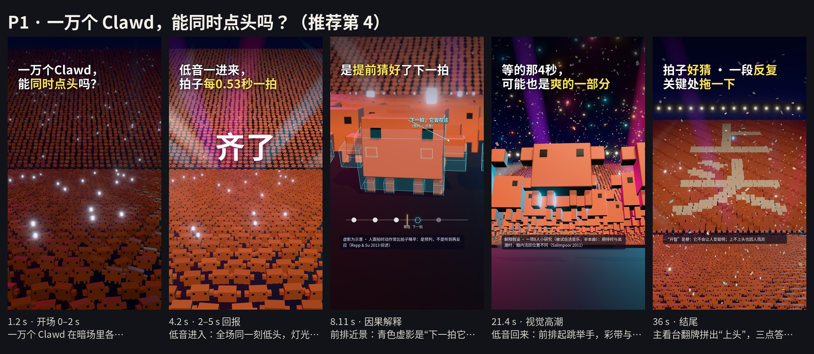
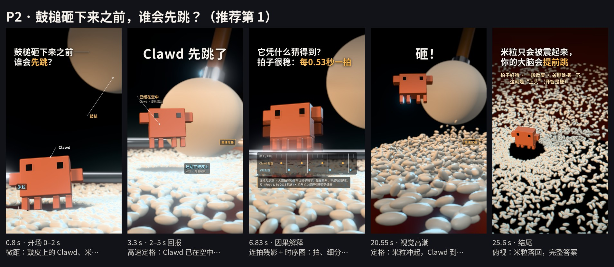
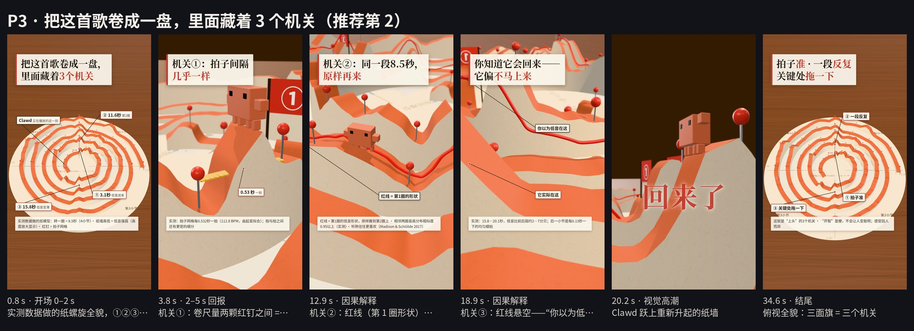
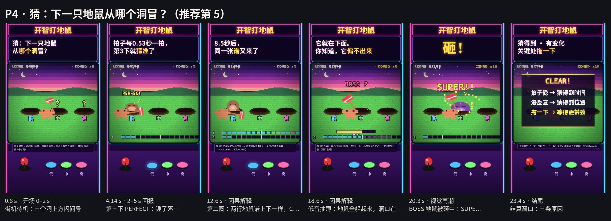
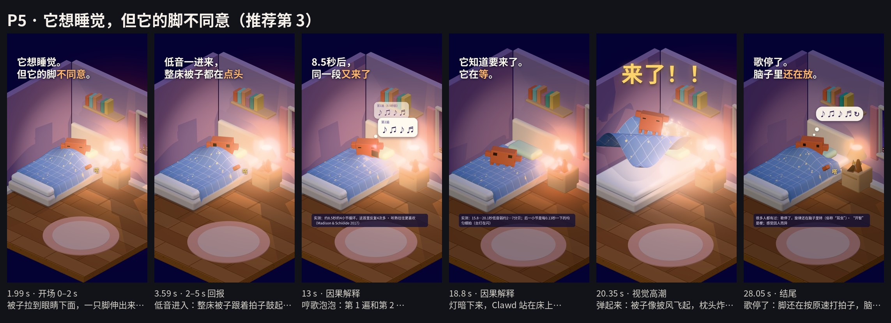

# 这首开智小曲为什么让人上头 · 五套提案

2026-10-21 · Claude Opus 5.5（创意、文案、画面代码、关键帧渲染与复核）；Codex 只提供资料与核查

> 提案阶段：每套 5–6 张真实渲染的竖屏关键帧（1080×1920），未制作全片。静帧只能确认风格、构图、角色和字幕，不能证明动效节奏和音乐体验；没有做手机端完整复审。

**音乐**：原录屏 BGM（sha256 6987131e…144b61，39.47 秒）。不变速、不改调、不压低音量，只在小节线收尾；无旁白，讲解全部是屏幕字幕。

打开 `index.html` 可以横向对比、点开看单帧大图。

## 推荐排序（我的判断）

| 排名 | 方案 | 一句话 | 片长 | 为什么这样排 |
|---|---|---|---|---|
| 1 | P2 鼓槌砸下来之前，谁会先跳？ | 微距镜头下，米粒只会被鼓槌震起来，Clawd 却总在撞击前起跳——“提前动”就是大脑在预测，这首歌把这种预测喂得刚刚好。 | 27.0 s | 问题最短、回报最快、机制最集中：二选一的问题第 1 秒抛出，3.06 秒用一帧定格揭晓反直觉的答案，而这个答案正是全片核心；27 秒内讲完三点并收束；微距质感少见。主要风险是运动设计要做干净。 |
| 2 | P3 把这首歌卷成一盘，里面藏着 3 个机关 | 用原曲实测数据做一盘纸螺旋：一圈 = 8.5 秒，纸墙高低 = 低音强弱，红钉 = 拍子；Clawd 沿着“正在播放的那一刻”走，用卷尺、描图红线和一道塌陷，把三个机关逐个找出来。 | 35.5 s | 讲解最扎实、最可能让人“原来如此”：所有形状来自实测，三个机关逐项兑现。代价是 35 秒和较高的信息密度；如果账号想强化硬核科普形象，它可以排第一。 |
| 3 | P5 它想睡觉，但它的脚不同意 | 睡前的 Clawd 被这首歌一步步“拿下”：脚先打拍子、被子跟着点头、第二遍开始跟着哼、低音一抽它就蹲着等、回来时连人带被弹起——歌停了，脚还在打拍子。 | 29.0 s | 最有共鸣、结尾最好：把“上头”变成观众自己的体验。代价是科学信息最轻、笑点因人而异、结尾无声段有流失风险。 |
| 4 | P1 一万个 Clawd，能同时点头吗？ | 夜间体育场里 10,028 个 Clawd：前奏时各点各的，低音一进来全场对齐；它们靠的是同时预判下一拍，人浪第二圈提前站好，两次“拖”全场屏息，最后翻牌拼出“上头”。 | 37.9 s | 最壮观，翻牌“上头”是很强的结尾画面；但解释手段不如 P2/P3 独特，片长最长、制作最重，小屏远景有糊成纹理的风险。 |
| 5 | P4 猜：下一只地鼠从哪个洞冒？ | 一台像素街机：地鼠冒头的时刻 = 实测拍子，从哪个洞冒 = 实测低音高低；观众和 Clawd 一起猜，猜错一次、猜准一次、背下整张谱，再等 BOSS。 | 24.8 s | 最短、最能玩，规则来自实测数据；但调性偏低龄，适合当作一条“短版互动”实验，而不是主推方案。 |

## 五套的实质差别

| | 视觉语言 | 叙事机制 | 情绪 | 与其他四套的差别 |
|---|---|---|---|---|
| P1 万人点头 | 3D 夜间体育场群像：舞台视角俯拍、人群近景、高空全景、翻牌组字 | 群体同步：一万个 Clawd = 一万个在猜拍子的大脑；“能不能同时点头”是画面上可检验的结果 | 燃、震撼、集体感 | 五套里唯一的“群体”视角：用一万个个体能否同步来证明“可预测”，奇观感最强。 |
| P2 谁先跳 | 3D 微距“高速摄影”：鼓皮表面、米粒、毛毡鼓槌，浅景深、定格瞬间、连拍残影 | 对照实验：同一画面里，米粒（撞击后才动 = 反应）和 Clawd（撞击前就动 = 预测）的先后顺序就是答案；之后用连拍、长曝光、定格这些“摄影动作”逐项讲 | 惊奇、解压；定格瞬间的“啊原来如此” | 五套里唯一的“对照实验”：答案藏在同一画面里两种运动的先后，不靠图表；微距实拍质感。 |
| P3 卷成一盘 | 3D 纸艺数据模型：木桌上的纸螺旋（时间卷成圈）、测绘红钉、红色描图线；暖光窗边光、轻微移轴 | 取证拆解：每个机关对应一个测量动作——拉尺量间隔（①）、把第 1 圈的形状描成红线搬到第 2 圈（②）、红线悬空露出低音塌陷（③） | 好奇、恍然、信服 | 五套里唯一的“真数据可视化”：整首歌的实测数据就是场景本身；红线 = 期待、纸墙 = 现实。 |
| P4 打地鼠 | 2D 像素街机：霓虹机身 + CRT 显像管（扫描线、辉光、暗角） | 游戏挑战：观众从第 1 秒就在猜；LATE / PERFECT / MISS 的反馈就是“预测”本身；16 格“地鼠谱”让重复看得见 | 参与、爽快、轻松 | 五套里唯一的“观众参与”形式：观众自己在猜，猜中/猜错就是体验；最短。 |
| P5 停不下来 | 3D 等轴测小卧室（黏土/软胶质感），夜晚，台灯暖光与窗外月光 | 角色喜剧：每个“忍不住”的动作对应一个机制——脚打拍子（拍子可预测）→ 跟着哼（重复）→ 定住等（拖）→ 弹起（兑现）→ 歌停了脚还在打（上头本身） | 共鸣、好笑、温柔 | 五套里唯一的“角色喜剧”：没有图表和数据画面，全靠一个角色忍不住的行为来讲。 |

## 原曲实测（五套共用）

- **拍子**：112.8 BPM，拍子网格每 0.532 秒一拍，一小节 2.127 秒（由起音拟合）。网格是“拍”，拍与拍之间还有更密的细分，不是每个鼓点都隔 0.53 秒。
- **前奏与第一次回报**：0–3.06 秒低音很薄（比之后弱约 10 dB）；3.056 秒低音进入。五套都把这一拍当作 2–5 秒的第一次回报。
- **重复**：约 8.5 秒的 4 小节循环反复 4 次多：对应小节和声相似度 0.955–0.998，波形相关 0.87–0.95；相隔一圈的同一小节最佳对齐误差不到 10 毫秒。
- **两次“拖”**：15.82–20.07 秒与 28.58–32.84 秒：第 1 小节低音比前后弱约 4–7 dB，第 2 小节弱约 2–4 dB，并出现每 0.134 秒一下的均匀细拍；20.07 秒与 32.84 秒低音回到原来的厚度（约 −5.7 ~ −6.5 dB，与抽薄前相当）。
- **结尾**：文件在 39.47 秒处没有淡出、直接结束；各方案都在小节线（24.33 / 26.46 / 34.96 / 37.09 秒）收住。

测量脚本 `tools/measure_bgm.py`，结果 `src/music-map.json`。

## P1 · 一万个 Clawd，能同时点头吗？（推荐第 4）

**一行梗概**：夜间体育场里 10,028 个 Clawd：前奏时各点各的，低音一进来全场对齐；它们靠的是同时预判下一拍，人浪第二圈提前站好，两次“拖”全场屏息，最后翻牌拼出“上头”。

- **风格**：3D 夜间体育场群像：舞台视角俯拍、人群近景、高空全景、翻牌组字
- **色彩**：深靛夜空 #04061A、品红 #FF3D9A / 青 #33D6FF 光束、金色彩带；人群是一片官方橙
- **画面材质**：哑光塑料体块小人（像素 Clawd 立体化）、体积光束、薄雾、泛光
- **核心叙事机制**：群体同步：一万个 Clawd = 一万个在猜拍子的大脑；“能不能同时点头”是画面上可检验的结果
- **情绪体验**：燃、震撼、集体感
- **建议时长**：37.9 秒。用满两次“拖”：第一次体验，第二次让观众自己数、自己验证，最后用翻牌收束；38 秒是五套里最长的。
- **音乐剪辑**：原曲 0.00–37.09 s 不剪，37.09 s 最后一拍后 0.8 s 自然衰减（片时 = 原曲时间）

**为什么可能让人愿意继续看（假设，不保证完播）**

- 开场即一个可被画面检验的问题（齐不齐），3 秒给出结果。
- 大场面持续升级：对齐 → 人浪 → 全场起跳 → 翻牌。
- “下一次在 4 秒后，这回换你来猜”给观众一个任务。

**关键帧**

- [P1-1-open.jpg](keyframes/P1/P1-1-open.jpg) · 1.2 s · 开场 0–2 s：一万个 Clawd 在暗场里各点各的，抛出问题
- [P1-2-payoff.jpg](keyframes/P1/P1-2-payoff.jpg) · 4.2 s · 2–5 s 回报：低音进入：全场同一刻低头，灯光打亮
- [P1-3-cause.jpg](keyframes/P1/P1-3-cause.jpg) · 8.11 s · 因果解释：前排近景：青色虚影是“下一拍它会在这”，底部节拍条
- [P1-4-climax.jpg](keyframes/P1/P1-4-climax.jpg) · 21.4 s · 视觉高潮：低音回来：前排起跳举手，彩带与光束
- [P1-5-end.jpg](keyframes/P1/P1-5-end.jpg) · 36 s · 结尾：主看台翻牌拼出“上头”，三点答案

**开场**

| 时段 | 实际可见动作 | 信息回报 | 下一悬念 |
|---|---|---|---|
| 0–2 s | 舞台视角俯看全场：暗场里一万个橙色 Clawd 挤满场地和看台，各点各的、东张西望，零星手机光。 | 问题：一万个 Clawd，能同时点头吗？ | 会不会齐？ |
| 2–5 s | 3.06 秒低音进入那一拍：前排先对上，0.4 秒内波及全场，所有 Clawd 同一刻低头；灯光同时打亮。 | “齐了”+ 原因：低音一进来，拍子每 0.53 秒一拍。 | 它们是听到才点的吗？ |

**叙事单元（动作 → 后果 → 字幕讲清了什么 → 如何引出下一步）**

| 时间 (s) | 观众看到的动作 | 产生的后果 | 屏幕字幕 | 讲清了什么 | 引出下一步 |
|---|---|---|---|---|---|
| 0–3.06 | 暗场全景，一万个 Clawd 各点各的 | 画面像一锅粥 | 一万个Clawd， / 能同时点头吗？ | 提出可检验的问题 | 会不会齐 |
| 3.06–5.18 | 低音进入，前排先对上，0.4 秒内全场同一刻低头，灯光打亮 | 一万个动作变成一个 | 齐了 低音一进来， / 拍子每0.53秒一拍 | 拍子清楚、间隔稳定（每 0.53 秒一拍） | 是听到才点吗？ |
| 5.18–11.56 | 前排近景：头上叠着青色线框虚影，提前停在下一拍的位置；底部节拍条上下一拍是虚线圈 | 真身每次都落进虚影 | 可它们不是 / 听到才点头—— 是提前猜好了下一拍 注：虚影为示意 · 人跟拍时动作常比拍子略早：是预判，不是听到再反应（Repp & Su 2013 综述） 那第二遍呢？ | 不是听到才点，是提前猜好了下一拍；所有人猜同一个时刻 → 齐 | “那第二遍呢？” |
| 11.56–15.82 | 高空全景：看台人浪每转一圈 8.5 秒，第二圈人浪还没到，前面的看台就提前站起 | 人浪前沿出现“提前量” | 人浪转完一圈：8.5秒， / 同一段又来了 第二圈，人浪还没到， / 大家就站好了 注：实测：约8.5秒的4小节循环，这首里反复4次多（铺垫段有变化）· 听熟往往更喜欢（Madison & Schiölde 2017） | 同一段反复 → 能猜的从下一拍扩展到下一段；听熟往往更喜欢 | 低音被抽走 |
| 15.82–20.07 | 全场同时蹲下定格，场灯收成一束；后一小节看台手机灯按 0.13 秒一格亮起 | 一万个 Clawd 屏住呼吸 | 低音被抽薄了—— 都知道它要回来， / 它偏不马上来 注：实测：15.8—20.1秒低音弱约2—7分贝；后一小节是每0.13秒一下的均匀细拍 | 关键处故意拖一下，期待被拉长 | 手机灯走满 |
| 20.07–24.33 | 低音回来，全场起跳举手，光束炸开，彩带喷出 | 等待一次性兑现 | 回来了！ 等的那4秒， / 可能也是爽的一部分 注：解释假设 · 一项8人小研究（被试自选音乐，非本曲）：期待时与高潮时，脑内活跃位置不同（Salimpoor 2011） | 等的那 4 秒可能也是爽的一部分（解释假设） | 下一次在 4 秒后 |
| 24.33–28.58 | 前排一只 Clawd 转向镜头，其余照常点头 | 观众被邀请预测 | 下一次低音抽走， / 在4秒后 这回，换你来猜 | 把机制交给观众 | 第二次抽薄 |
| 28.58–32.84 | 全场再次蹲下；字幕随四拍数 4·3·2·1 | 观众自己在等 | 你也在等了， / 对吧？ 4 3 2 1 | 观众亲身验证“猜得到 + 被拖一下” | 第二次回来 |
| 32.84–37.9 | 第二次起跳；主看台同时翻牌，拼出巨大的“上头”；37.09 秒最后一拍全场举手定格，音乐自然衰减 | 万人同步成为答案本身 | 拍子好猜 · 一段反复 / 关键处拖一下 注：“开智”是梗：它不会让人变聪明；上不上头也因人而异 | 拍子好猜 · 一段反复 · 关键处拖一下 | （结束） |

**结尾怎样答完**：翻牌的“上头”与三点字幕同时出现，最后一拍定格；不加关注卡。

**完整字幕（按时间，可直接用于成片）**

| 出现 (s) | 消失 (s) | 类型 | 文字 |
|---|---|---|---|
| 0.00 | 3.00 | 主字幕 | 一万个Clawd， / 能同时点头吗？ |
| 3.06 | 5.18 | 大字 | 齐了 |
| 3.60 | 5.18 | 主字幕 | 低音一进来， / 拍子每0.53秒一拍 |
| 5.18 | 7.30 | 主字幕 | 可它们不是 / 听到才点头—— |
| 7.31 | 9.43 | 主字幕 | 是提前猜好了下一拍 |
| 5.18 | 11.50 | 注释（小字） | 虚影为示意 · 人跟拍时动作常比拍子略早：是预判，不是听到再反应（Repp & Su 2013 综述） |
| 9.44 | 11.50 | 主字幕 | 那第二遍呢？ |
| 11.56 | 13.68 | 主字幕 | 人浪转完一圈：8.5秒， / 同一段又来了 |
| 13.69 | 15.80 | 主字幕 | 第二圈，人浪还没到， / 大家就站好了 |
| 11.56 | 15.80 | 注释（小字） | 实测：约8.5秒的4小节循环，这首里反复4次多（铺垫段有变化）· 听熟往往更喜欢（Madison & Schiölde 2017） |
| 15.82 | 17.94 | 主字幕 | 低音被抽薄了—— |
| 17.95 | 20.06 | 主字幕 | 都知道它要回来， / 它偏不马上来 |
| 15.82 | 20.06 | 注释（小字） | 实测：15.8—20.1秒低音弱约2—7分贝；后一小节是每0.13秒一下的均匀细拍 |
| 20.07 | 21.20 | 大字 | 回来了！ |
| 21.20 | 24.30 | 主字幕 | 等的那4秒， / 可能也是爽的一部分 |
| 21.20 | 24.30 | 注释（小字） | 解释假设 · 一项8人小研究（被试自选音乐，非本曲）：期待时与高潮时，脑内活跃位置不同（Salimpoor 2011） |
| 24.33 | 26.44 | 主字幕 | 下一次低音抽走， / 在4秒后 |
| 26.45 | 28.57 | 主字幕 | 这回，换你来猜 |
| 28.58 | 30.70 | 主字幕 | 你也在等了， / 对吧？ |
| 30.71 | 31.24 | 倒数 | 4 |
| 31.24 | 31.77 | 倒数 | 3 |
| 31.77 | 32.30 | 倒数 | 2 |
| 32.30 | 32.83 | 倒数 | 1 |
| 33.20 | 37.90 | 主字幕 | 拍子好猜 · 一段反复 / 关键处拖一下 |
| 35.30 | 37.90 | 注释（小字） | “开智”是梗：它不会让人变聪明；上不上头也因人而异 |

**容易流失的点与取舍**

- 手机小屏上，远景人群可能糊成一片橙色纹理：要靠乱点头的抖动和清楚的问题字幕撑住前 2 秒。
- 37.9 秒最长；“换你来猜”段（24–33 秒）新信息少，可能流失 —— 可剪成到 24.3 秒的单 drop 版。
- 制作量最大（万人群体动画、光束、翻牌），渲染成本最高。
- “预判虚影”与 P5 的节拍器虚线是相近的解释手段。

**私下对比用的开场 B 版**：开场 B 版：第一帧先给前排三只 Clawd 的近景（各点各的），1.5 秒拉成全景再出问题。

**静帧证明不了的**：一万个体的同步、人浪和翻牌在运动中的冲击力只能在动态里判断。

## P2 · 鼓槌砸下来之前，谁会先跳？（推荐第 1）

**一行梗概**：微距镜头下，米粒只会被鼓槌震起来，Clawd 却总在撞击前起跳——“提前动”就是大脑在预测，这首歌把这种预测喂得刚刚好。

- **风格**：3D 微距“高速摄影”：鼓皮表面、米粒、毛毡鼓槌，浅景深、定格瞬间、连拍残影
- **色彩**：近黑背景；琥珀暖主光 #FFC78E、冷青轮廓光 #86DCFF；米白鼓皮、白米粒；Clawd 官方橙
- **画面材质**：纤维鼓皮（凹凸贴图）、毛毡绒面（sheen）、半光泽米粒、镀铬鼓圈虚化成光斑
- **核心叙事机制**：对照实验：同一画面里，米粒（撞击后才动 = 反应）和 Clawd（撞击前就动 = 预测）的先后顺序就是答案；之后用连拍、长曝光、定格这些“摄影动作”逐项讲
- **情绪体验**：惊奇、解压；定格瞬间的“啊原来如此”
- **建议时长**：27.0 秒。只用第一次“拖”和 drop：一个核心发现（预测）+ 两个放大器（重复、拖），27 秒足够讲完并留 2.6 秒收尾。
- **音乐剪辑**：原曲 0.00–26.455 s 不剪，在小节线收住 + 0.5 s 自然衰减；画面在 3.056 s（撞击瞬间）与 20.38 s（米粒冠最高时）两处“高速定格”约 0.4 s，音乐不停

**为什么可能让人愿意继续看（假设，不保证完播）**

- 第 1 秒抛出二选一问题，观众会先押一个答案；3 秒就揭晓，而且答案反直觉。
- 揭晓的那一帧本身就是全片的核心论点（提前动 = 预测），之后每段都在同一个微距世界里推进，不需要换场景重新理解。
- 定格、连拍、长曝光是高速摄影的视觉奖励，同时各承担一个解释。

**关键帧**

- [P2-1-open.jpg](keyframes/P2/P2-1-open.jpg) · 0.8 s · 开场 0–2 s：微距：鼓皮上的 Clawd、米粒、悬着的毛毡鼓槌
- [P2-2-payoff.jpg](keyframes/P2/P2-2-payoff.jpg) · 3.3 s · 2–5 s 回报：高速定格：Clawd 已在空中，米粒还贴在鼓皮上
- [P2-3-cause.jpg](keyframes/P2/P2-3-cause.jpg) · 6.83 s · 因果解释：连拍残影 + 时序图：拍、细分、谁先起跳
- [P2-4-climax.jpg](keyframes/P2/P2-4-climax.jpg) · 20.55 s · 视觉高潮：定格：米粒冲起，Clawd 到最高点
- [P2-5-end.jpg](keyframes/P2/P2-5-end.jpg) · 25.6 s · 结尾：俯视：米粒落回，完整答案

**开场**

| 时段 | 实际可见动作 | 信息回报 | 下一悬念 |
|---|---|---|---|
| 0–2 s | 微距：Clawd 站在鼓皮上的米粒之间，仰头看悬在上方的毛毡鼓槌；前奏低音薄，米粒只细微地抖；画面标注“米粒 / Clawd / 鼓槌”。 | 一个二选一的问题：鼓槌砸下来之前，谁会先跳？ | 等第一下重拍。 |
| 2–5 s | 3.06 秒第一下重拍砸下，画面“高速定格”0.4 秒（音乐不停）：Clawd 已在半空，米粒还贴在鼓皮上；恢复播放后米粒才弹起。 | 答案 + 第一个原理：米粒是被震起来的（反应），Clawd 是猜到了才跳（预测）。 | 它凭什么猜得到？ |

**叙事单元（动作 → 后果 → 字幕讲清了什么 → 如何引出下一步）**

| 时间 (s) | 观众看到的动作 | 产生的后果 | 屏幕字幕 | 讲清了什么 | 引出下一步 |
|---|---|---|---|---|---|
| 0–3.06 | 微距开场，Clawd 仰头看鼓槌，米粒细微抖动 | 观众先在心里押一个答案 | 鼓槌砸下来之前—— / 谁会先跳？ | 提出“反应 vs 预测”的检验 | 等第一下重拍 |
| 3.06–5.18 | 第一下重拍：定格 0.4 秒，Clawd 已在空中，米粒还没动；之后米粒才弹起 | 先后顺序一眼可见 | Clawd 先跳了 米粒：被震起来的 / Clawd：猜到了才跳 | 米粒 = 被震起来（反应）；Clawd = 猜到了才跳（预测） | 它凭什么猜得到？ |
| 5.18–9.44 | 正面“连拍”：Clawd 每次起跳叠成一串半透明残影；底部时序图：粗刻度 = 拍子（0.53 秒），细刻度 = 更密的细分，橙点（Clawd 起跳）总在粗刻度前，蓝点（米粒）总在后 | 起跳总比撞击早一点 | 它凭什么猜得到？ / 拍子很稳：每0.53秒一拍 听两三拍， / 就能算出下一拍 注：连拍为示意 · 人跟拍时动作常比拍子略早：是在预判，不是听到再反应（Repp & Su 2013 综述）· 拍与拍之间还有更密的细分 | 拍子稳 → 听两三拍就能算出下一拍；人跟拍时也常略早于拍子 | “而且，这段还会再来” |
| 9.44–15.82 | 长曝光：米粒每次弹跳在空中留下光迹，第二圈的光迹叠在第一圈上几乎重合；Clawd 闭着眼也落在点上 | 整段节奏变成可背下来的形状 | 而且，这段还会再来 8.5秒后， / 同一段原样再来 第二遍， / 闭着眼都能跳 注：长曝光为示意 · 实测：约8.5秒的4小节循环在这首里反复4次多 · 听熟往往更喜欢（Madison & Schiölde 2017） | 同一段 8.5 秒原样再来 → 能猜的从“下一拍”扩展到“下一段”；听熟往往更喜欢 | 鼓槌突然停了 |
| 15.82–20.07 | 鼓槌高高抬起不落，鼓皮静下来、米粒落定；后一小节米粒按 0.13 秒的细拍密密地颤；Clawd 蹲低、睁大眼、蓄力 | 预期的那一下迟迟不来 | 这时，低音被抽薄了 米粒停了，Clawd 没停—— / 它在等 注：实测：15.8—20.1秒低音弱约2—7分贝；后一小节是每0.13秒一下的均匀细拍 | 低音被抽薄约 4 秒：期待被拉长 | 鼓槌开始下落 |
| 20.07–24.33 | 低音回来那一拍鼓槌砸下；0.3 秒后再次定格：米粒冲起一大片，Clawd 到最高点（它早就蹲好了） | 最大的一次释放 | 砸！ 其实低音只是 / 回到原来的厚度 可等了4秒， / 它就显得格外重 注：实测：回来后的低音与抽薄前相当 · “显得重”是期待带来的感受，因人而异 · 一项8人小研究（自选音乐，非本曲）：期待与高潮时脑内活跃位置不同（Salimpoor 2011） | 反直觉的一点：低音只是回到原来的厚度，是“等”让它显得格外重（解释假设） | 米粒落下 |
| 24.33–26.96 | 镜头升到俯视：鼓槌离开，米粒像雪一样落回，Clawd 站在中间的空地上；26.46 秒小节线后自然衰减 | 画面静下来 | 米粒只会被震起来， / 你的大脑会提前跳 拍子好猜 · 一段反复 · 关键处拖一下 / ——这就是“上头”（开智是梗） | 完整答案：米粒只会被震起来，你的大脑会提前跳；拍子好猜、一段反复、关键处拖一下 | （结束） |

**结尾怎样答完**：最后两行字幕直接回答开头问题，并把三点原因一次说完；鼓槌离场、米粒落定，音乐在小节线自然衰减，不加关注卡。

**完整字幕（按时间，可直接用于成片）**

| 出现 (s) | 消失 (s) | 类型 | 文字 |
|---|---|---|---|
| 0.00 | 3.00 | 主字幕 | 鼓槌砸下来之前—— / 谁会先跳？ |
| 3.06 | 3.90 | 大字 | Clawd 先跳了 |
| 3.90 | 5.18 | 主字幕 | 米粒：被震起来的 / Clawd：猜到了才跳 |
| 5.18 | 7.30 | 主字幕 | 它凭什么猜得到？ / 拍子很稳：每0.53秒一拍 |
| 7.31 | 9.43 | 主字幕 | 听两三拍， / 就能算出下一拍 |
| 5.18 | 9.43 | 注释（小字） | 连拍为示意 · 人跟拍时动作常比拍子略早：是在预判，不是听到再反应（Repp & Su 2013 综述）· 拍与拍之间还有更密的细分 |
| 9.44 | 11.56 | 主字幕 | 而且，这段还会再来 |
| 11.56 | 13.68 | 主字幕 | 8.5秒后， / 同一段原样再来 |
| 13.69 | 15.80 | 主字幕 | 第二遍， / 闭着眼都能跳 |
| 11.56 | 15.80 | 注释（小字） | 长曝光为示意 · 实测：约8.5秒的4小节循环在这首里反复4次多 · 听熟往往更喜欢（Madison & Schiölde 2017） |
| 15.82 | 17.94 | 主字幕 | 这时，低音被抽薄了 |
| 17.95 | 20.06 | 主字幕 | 米粒停了，Clawd 没停—— / 它在等 |
| 15.82 | 20.06 | 注释（小字） | 实测：15.8—20.1秒低音弱约2—7分贝；后一小节是每0.13秒一下的均匀细拍 |
| 20.07 | 21.20 | 大字 | 砸！ |
| 21.20 | 22.60 | 主字幕 | 其实低音只是 / 回到原来的厚度 |
| 22.60 | 24.30 | 主字幕 | 可等了4秒， / 它就显得格外重 |
| 21.20 | 24.30 | 注释（小字） | 实测：回来后的低音与抽薄前相当 · “显得重”是期待带来的感受，因人而异 · 一项8人小研究（自选音乐，非本曲）：期待与高潮时脑内活跃位置不同（Salimpoor 2011） |
| 24.33 | 26.96 | 主字幕 | 米粒只会被震起来， / 你的大脑会提前跳 |
| 24.90 | 26.96 | 副字幕 | 拍子好猜 · 一段反复 · 关键处拖一下 / ——这就是“上头”（开智是梗） |

**容易流失的点与取舍**

- 开场画面暗、主体小：如果 1 秒内看不出“鼓槌”是什么，问题就不成立 —— 用标注和鼓槌的晃动动势撑住，牺牲一点画面纯净。
- “高速定格”会打断律动：控制在 0.4 秒并配“高速定格”角标，避免像卡顿。
- 米粒/鼓皮是比喻，不是声学实验；每拍一锤是把“拍”可视化，不代表原曲每拍都有底鼓（注释已写“拍与拍之间还有更密的细分”）。
- “显得格外重”是感受解释，不是测量结论。

**私下对比用的开场 B 版**：开场 B 版（只改前 5 秒、私下比较）：第一帧更近（只看到 Clawd 的眼睛和米粒），字幕改为“米粒和它，谁先离开鼓面？”，1.2 秒再拉出鼓槌。

**静帧证明不了的**：米粒冲起、鼓皮涟漪、鼓槌弹回的运动质量只能在动态里判断；本轮只验证了定格构图。

## P3 · 把这首歌卷成一盘，里面藏着 3 个机关（推荐第 2）

**一行梗概**：用原曲实测数据做一盘纸螺旋：一圈 = 8.5 秒，纸墙高低 = 低音强弱，红钉 = 拍子；Clawd 沿着“正在播放的那一刻”走，用卷尺、描图红线和一道塌陷，把三个机关逐个找出来。

- **风格**：3D 纸艺数据模型：木桌上的纸螺旋（时间卷成圈）、测绘红钉、红色描图线；暖光窗边光、轻微移轴
- **色彩**：象牙纸 #F5EDDC、陶土橙纸墙顶 #C9643D、红钉/红线 #D7392B、木桌棕；Clawd 官方橙
- **画面材质**：纤维纸、纸边投影、镀铬针、黄色卷尺、木纹桌面
- **核心叙事机制**：取证拆解：每个机关对应一个测量动作——拉尺量间隔（①）、把第 1 圈的形状描成红线搬到第 2 圈（②）、红线悬空露出低音塌陷（③）
- **情绪体验**：好奇、恍然、信服
- **建议时长**：35.5 秒。三个机关各需要一次“测量”画面，再用第二次“拖”让观众自己读图预测；35 秒是讲完且让观众验证一次的最短长度。
- **音乐剪辑**：原曲 0.00–34.963 s 不剪，在小节线收住 + 0.5 s 自然衰减（片时 = 原曲时间；Clawd 的位置 = 正在播放的那一刻；纸螺旋每转一圈 = 实测 4 小节 8.508 s）

**为什么可能让人愿意继续看（假设，不保证完播）**

- 开头承诺一个三项清单，三面旗让进度看得见：3.1 秒给①、11.6 秒给②、15.8 秒给③，不把答案压到最后。
- 所有形状都来自原曲实测，红线 = “你以为”、纸墙 = “实际”，把“拖”讲成一个看得见的落差。
- 第二次“拖”时观众已经会读这张图，会自己数 4·3·2·1。

**关键帧**

- [P3-1-open.jpg](keyframes/P3/P3-1-open.jpg) · 0.8 s · 开场 0–2 s：实测数据做的纸螺旋全貌，①②③三面旗
- [P3-2-payoff.jpg](keyframes/P3/P3-2-payoff.jpg) · 3.8 s · 2–5 s 回报：机关①：卷尺量两颗红钉之间 = 0.53 秒
- [P3-3-cause.jpg](keyframes/P3/P3-3-cause.jpg) · 12.9 s · 因果解释：机关②：红线（第 1 圈形状）贴合第 2 圈
- [P3-4-gap.jpg](keyframes/P3/P3-4-gap.jpg) · 18.9 s · 因果解释：机关③：红线悬空——“你以为低音在这 / 它实际在这”
- [P3-5-climax.jpg](keyframes/P3/P3-5-climax.jpg) · 20.2 s · 视觉高潮：Clawd 跃上重新升起的纸墙
- [P3-6-end.jpg](keyframes/P3/P3-6-end.jpg) · 34.6 s · 结尾：俯视全貌：三面旗 = 三个机关

**开场**

| 时段 | 实际可见动作 | 信息回报 | 下一悬念 |
|---|---|---|---|
| 0–2 s | 俯拍木桌上的纸螺旋：整首歌卷成一盘，三面红旗①②③插在不同位置，中心附近一个小 Clawd（正在播放的这一刻）。 | 承诺：这首歌里藏着 3 个机关；注释说明纸墙 = 低音、红钉 = 拍子。 | 第一个机关在哪？ |
| 2–5 s | 镜头落到纸墙顶：3.06 秒低音进入，纸墙在①号旗处升高；Clawd 拉开黄色卷尺，量两颗红钉之间。 | 机关①：拍子间隔几乎一样，0.53 秒一拍（实测）。 | 这么准，有什么用？ |

**叙事单元（动作 → 后果 → 字幕讲清了什么 → 如何引出下一步）**

| 时间 (s) | 观众看到的动作 | 产生的后果 | 屏幕字幕 | 讲清了什么 | 引出下一步 |
|---|---|---|---|---|---|
| 0–3.06 | 俯拍纸螺旋全貌：①②③三面旗、中心的小 Clawd | 观众拿到一张“地图”和一个三项清单 | 把这首歌卷成一盘， / 里面藏着3个机关 注：实测数据做的纸模型：转一圈 = 8.5秒（4小节）· 纸墙高低 = 低音强弱（高度放大显示）· 红钉 = 拍子网格 | 这首歌可以被拆开看 | 找机关① |
| 3.06–5.18 | 纸墙顶上，Clawd 用卷尺量两颗红钉：0.53 秒 | 第一个答案在 5 秒内给出 | 机关①：拍子间隔 / 几乎一样 注：实测：拍子网格每0.532秒一拍（112.8 BPM，由起音拟合）；拍与拍之间还有更密的细分 | 机关①：拍子间隔几乎一样 | 这么准有什么用？ |
| 5.18–11.56 | Clawd 往前走，红钉一颗颗出现在它前方；转完一圈，16 颗钉落在同一根辐条上 | 节拍稳定到整圈都对得上 | 一圈16拍，每圈都落在 / 同一根辐条上 拍子准， / 大脑就能提前猜下一拍 注：实测：相隔一圈的同一小节，最佳对齐误差不到10毫秒 · 跟拍时动作常略早于拍子（Repp & Su 2013 综述） 转完一圈， / 回到同一个位置—— | 拍子准 → 大脑能提前猜下一拍 | 转完一圈，回到同一个位置 |
| 11.56–15.82 | 第 1 圈的低音形状被描成一根红线，原样搬到第 2 圈上方，和纸墙严丝合缝 | 两圈形状一样 | 机关②：同一段8.5秒， / 原样再来 越听越熟，越好猜， / 也更容易喜欢 注：红线 = 第1圈的低音形状，原样搬到第2圈上 · 相邻两圈音高分布相似度0.95以上（实测）· 听熟往往更喜欢（Madison & Schiölde 2017） | 机关②：同一段 8.5 秒原样再来；越熟越好猜，也往往更喜欢 | 红线和纸墙马上要分开 |
| 15.82–20.07 | 第 2 圈后半纸墙塌下去一截，红线还悬在原来的高度：“你以为低音在这 / 它实际在这”；Clawd 在塌陷处蹲着等 | 期待与现实之间出现一道看得见的落差 | 机关③：高潮前， / 把低音抽薄4秒 你知道它会回来—— / 它偏不马上来 注：实测：15.8—20.1秒，低音比前后弱约2—7分贝；后一小节是每0.13秒一下的均匀细拍 | 机关③：高潮前把低音抽薄 4 秒，你知道它会回来，它偏不马上来 | 纸墙在 12 点方向升起 |
| 20.07–24.33 | Clawd 从塌陷处跃上重新升起的纸墙（第 3 圈起点，和①②在同一根辐条上） | 落差被填平 | 回来了 期待和到来， / 可能是两种爽 注：解释假设 · 一项8人小研究（被试自选音乐，非本曲）：期待与高潮时，脑内活跃位置不同（Salimpoor 2011） | 期待和到来，可能是两种爽（解释假设） | 前面还有一道 |
| 24.33–28.58 | 镜头升高：第 4 圈上能看到第二道塌陷 | 观众已经会读这张图 | 前面还有一道—— / 这回你认得了 知道它要来， / 还是想等 | 知道它要来，还是想等 | 换你来数 |
| 28.58–32.84 | Clawd 坐在第二道塌陷边；字幕随第二小节四拍数 4·3·2·1 | 观众自己预测并被验证 | 这次，换你来数 4 3 2 1 | “猜得到 + 被拖一下”由观众亲身经历 | 第二次回来 |
| 32.84–35.46 | Clawd 第二次跃上；镜头回到俯视，三面旗标出：①拍子准 ②一段反复 ③关键处拖一下；34.96 秒小节线后衰减 | 地图被完整读完 | 拍子准 · 一段反复 / 关键处拖一下 注：这就是“上头”的3个机关 · “开智”是梗，不会让人变聪明；感受因人而异 | 三个机关 = 上头的原因 | （结束） |

**结尾怎样答完**：回到开场的俯视构图，三面旗的标签就是答案；与开场形成闭环。

**完整字幕（按时间，可直接用于成片）**

| 出现 (s) | 消失 (s) | 类型 | 文字 |
|---|---|---|---|
| 0.00 | 3.00 | 主字幕 | 把这首歌卷成一盘， / 里面藏着3个机关 |
| 0.00 | 3.00 | 注释（小字） | 实测数据做的纸模型：转一圈 = 8.5秒（4小节）· 纸墙高低 = 低音强弱（高度放大显示）· 红钉 = 拍子网格 |
| 3.06 | 5.18 | 主字幕 | 机关①：拍子间隔 / 几乎一样 |
| 5.18 | 7.30 | 主字幕 | 一圈16拍，每圈都落在 / 同一根辐条上 |
| 7.31 | 9.43 | 主字幕 | 拍子准， / 大脑就能提前猜下一拍 |
| 3.06 | 5.18 | 注释（小字） | 实测：拍子网格每0.532秒一拍（112.8 BPM，由起音拟合）；拍与拍之间还有更密的细分 |
| 5.18 | 9.43 | 注释（小字） | 实测：相隔一圈的同一小节，最佳对齐误差不到10毫秒 · 跟拍时动作常略早于拍子（Repp & Su 2013 综述） |
| 9.44 | 11.56 | 主字幕 | 转完一圈， / 回到同一个位置—— |
| 11.56 | 13.68 | 主字幕 | 机关②：同一段8.5秒， / 原样再来 |
| 13.69 | 15.80 | 主字幕 | 越听越熟，越好猜， / 也更容易喜欢 |
| 11.56 | 15.80 | 注释（小字） | 红线 = 第1圈的低音形状，原样搬到第2圈上 · 相邻两圈音高分布相似度0.95以上（实测）· 听熟往往更喜欢（Madison & Schiölde 2017） |
| 15.82 | 17.94 | 主字幕 | 机关③：高潮前， / 把低音抽薄4秒 |
| 17.95 | 20.06 | 主字幕 | 你知道它会回来—— / 它偏不马上来 |
| 15.82 | 20.06 | 注释（小字） | 实测：15.8—20.1秒，低音比前后弱约2—7分贝；后一小节是每0.13秒一下的均匀细拍 |
| 20.07 | 21.20 | 大字 | 回来了 |
| 21.20 | 24.30 | 主字幕 | 期待和到来， / 可能是两种爽 |
| 21.20 | 24.30 | 注释（小字） | 解释假设 · 一项8人小研究（被试自选音乐，非本曲）：期待与高潮时，脑内活跃位置不同（Salimpoor 2011） |
| 24.33 | 26.44 | 主字幕 | 前面还有一道—— / 这回你认得了 |
| 26.45 | 28.57 | 主字幕 | 知道它要来， / 还是想等 |
| 28.58 | 30.70 | 主字幕 | 这次，换你来数 |
| 30.71 | 31.24 | 倒数 | 4 |
| 31.24 | 31.77 | 倒数 | 3 |
| 31.77 | 32.30 | 倒数 | 2 |
| 32.30 | 32.83 | 倒数 | 1 |
| 32.84 | 35.46 | 主字幕 | 拍子准 · 一段反复 / 关键处拖一下 |
| 33.50 | 35.46 | 注释（小字） | 这就是“上头”的3个机关 · “开智”是梗，不会让人变聪明；感受因人而异 |

**容易流失的点与取舍**

- 开场 1 秒需要读懂“这是一首歌”：可能被当成手工视频划走 —— 用“3 个机关”的清单承诺换取继续看的理由。
- 信息密度五套最高，注释小字在手机上读不完：主字幕必须自洽，注释留给愿意暂停的人。
- 35 秒，第二次“拖”（24–33 秒）新信息少；若数据显示此处流失明显，可剪成到 24.3 秒的单 drop 版。
- 纸墙高度做了放大（注释已写“高度放大显示”）。

**私下对比用的开场 B 版**：开场 B 版：第一帧从 Clawd 拿卷尺的近景开始，1.5 秒拉出整盘螺旋，字幕不变。

**静帧证明不了的**：纸螺旋在运动中的可读性（镜头沿螺旋前进时会不会晕）需要动态验证。

## P4 · 猜：下一只地鼠从哪个洞冒？（推荐第 5）

**一行梗概**：一台像素街机：地鼠冒头的时刻 = 实测拍子，从哪个洞冒 = 实测低音高低；观众和 Clawd 一起猜，猜错一次、猜准一次、背下整张谱，再等 BOSS。

- **风格**：2D 像素街机：霓虹机身 + CRT 显像管（扫描线、辉光、暗角）
- **色彩**：街机紫 #1A0733、霓虹粉 #FF3FB4 / 青 #38E1FF、黄昏天空、草地绿、金币黄；Clawd 官方橙像素
- **画面材质**：像素点阵、扫描线、玻璃反光、塑料按键
- **核心叙事机制**：游戏挑战：观众从第 1 秒就在猜；LATE / PERFECT / MISS 的反馈就是“预测”本身；16 格“地鼠谱”让重复看得见
- **情绪体验**：参与、爽快、轻松
- **建议时长**：24.8 秒。游戏节奏适合短：一次完整循环 + 一次“拖”与 BOSS，24.3 秒小节线收住。
- **音乐剪辑**：原曲 0.00–24.328 s 不剪，在小节线收住 + 0.5 s 自然衰减（片时 = 原曲时间）

**为什么可能让人愿意继续看（假设，不保证完播）**

- 观众从第 1 秒就在玩，每一拍都有即时反馈。
- 规则本身就是实测数据（拍子 = 冒头时刻，低音高低 = 洞位）。
- 五套里最短。

**关键帧**

- [P4-1-open.jpg](keyframes/P4/P4-1-open.jpg) · 0.8 s · 开场 0–2 s：街机待机：三个洞上方闪问号
- [P4-2-payoff.jpg](keyframes/P4/P4-2-payoff.jpg) · 4.14 s · 2–5 s 回报：第三下 PERFECT：锤子落下的同时地鼠冒头
- [P4-3-cause.jpg](keyframes/P4/P4-3-cause.jpg) · 12.6 s · 因果解释：第二圈：两行地鼠谱上下一样，Clawd 闭眼打
- [P4-4-wait.jpg](keyframes/P4/P4-4-wait.jpg) · 18.6 s · 因果解释：低音抽薄：地鼠全躲起来，洞口在抖，蓄力
- [P4-5-climax.jpg](keyframes/P4/P4-5-climax.jpg) · 20.3 s · 视觉高潮：BOSS 地鼠被砸中：SUPER!!
- [P4-6-end.jpg](keyframes/P4/P4-6-end.jpg) · 23.4 s · 结尾：结算窗口：三条原因

**开场**

| 时段 | 实际可见动作 | 信息回报 | 下一悬念 |
|---|---|---|---|
| 0–2 s | 街机屏幕亮起：三个洞（低 / 中 / 高）上方闪着问号，Clawd 举着小锤站在中间；注释写明规则 = 实测。 | 问题：下一只地鼠从哪个洞冒？ | 第一只什么时候出来？ |
| 2–5 s | 3.06 秒第一只从“低”洞冒出，Clawd 慢了（LATE）；第二只 GOOD；第三只 PERFECT——锤子落下的同时地鼠冒头。 | 拍子每 0.53 秒一拍，第 3 下就猜准了。 | 锤子为什么能先落？ |

**叙事单元（动作 → 后果 → 字幕讲清了什么 → 如何引出下一步）**

| 时间 (s) | 观众看到的动作 | 产生的后果 | 屏幕字幕 | 讲清了什么 | 引出下一步 |
|---|---|---|---|---|---|
| 0–3.06 | 街机待机，三个洞上方闪问号 | 观众开始猜 | 猜：下一只地鼠 / 从哪个洞冒？ 注：冒头时刻 = 实测拍子网格；从哪个洞冒 = 实测低音的大致高低（色度粗测：低 / 中 / 高） | 把预测做成游戏 | 第一只 |
| 3.06–5.18 | 第一只 LATE、第二只 GOOD、第三只 PERFECT | 三拍之内学会 | 左！…… / 第一下，Clawd 慢了 拍子每0.53秒一拍， / 第3下就猜准了 | 拍子稳 → 几下之后就能预判 | 锤子为什么能先落 |
| 5.18–11.56 | 锤子先落、地鼠后冒；第 3 小节地鼠突然换到“中”洞（MISS，“咦？”），第 4 小节右边一下再回左；底部地鼠谱一格格填满 | 规律里出现小变化 | 锤子先落，地鼠后冒—— / 它在预判 注：人跟拍时动作常比拍子略早：是在预判，不是听到再反应（Repp & Su 2013 综述） 第3小节：咦， / 换到中间了 第4小节：右边一下， / 再回到左边 注：规律里藏一点变化：一项和弦研究发现，很好猜的地方来点意外，听感可能更好（Cheung 2019，非本曲） | 预判；规律中有一点意外（低音在第 3、4 小节挪位置） | 这张谱还会再来吗 |
| 11.56–15.82 | 第二圈：屏幕上两行地鼠谱上下一样，Clawd 闭眼连击 PERFECT | 位置也能背下来 | 8.5秒后， / 同一张谱又来了 第二圈： / 闭着眼都打得中 注：实测：约8.5秒的4小节循环，这首里反复4次多 · 听熟往往更喜欢（Madison & Schiölde 2017） | 同一段反复 → 连位置都猜得到；听熟往往更喜欢 | 地鼠不见了 |
| 15.82–20.07 | 低音抽薄：没有地鼠出来，中间洞口按 0.13 秒细拍抖动冒灰，屏幕闪“BOSS ?”，蓄力条涨满 | 等待被游戏化 | 低音被抽薄—— / 地鼠全躲起来了 它就在下面。 / 你知道，它偏不出来 注：实测：15.8—20.1秒低音弱约2—7分贝；后一小节是每0.13秒一下的均匀细拍（洞口在抖） | 关键处故意拖一下 | BOSS |
| 20.07–22.2 | BOSS 地鼠冒出的同一刻被砸中：屏幕震动、金币喷出、SUPER!! | 释放 | 砸！ 等出来的那一锤， / 可能格外过瘾 注：解释假设 · 一项8人小研究（被试自选音乐，非本曲）：期待与高潮时，脑内活跃位置不同（Salimpoor 2011） | 等出来的那一锤，可能格外过瘾（解释假设） | 结算 |
| 22.2–24.83 | 结算窗口 CLEAR!：拍子稳 → 猜得到时间 / 谱反复 → 猜得到位置 / 拖一下 → 等得更带劲 | 游戏结束 | 猜得到 · 有变化 / 关键处拖一下 注：这就是它“上头”的地方 · “开智”是梗，不会让人变聪明；感受因人而异 | 三点答案 | （结束） |

**结尾怎样答完**：用游戏结算窗口给出三点答案，24.33 秒小节线收住。

**完整字幕（按时间，可直接用于成片）**

| 出现 (s) | 消失 (s) | 类型 | 文字 |
|---|---|---|---|
| 0.00 | 3.00 | 主字幕 | 猜：下一只地鼠 / 从哪个洞冒？ |
| 0.00 | 3.00 | 注释（小字） | 冒头时刻 = 实测拍子网格；从哪个洞冒 = 实测低音的大致高低（色度粗测：低 / 中 / 高） |
| 3.06 | 3.85 | 主字幕 | 左！…… / 第一下，Clawd 慢了 |
| 3.85 | 5.18 | 主字幕 | 拍子每0.53秒一拍， / 第3下就猜准了 |
| 5.18 | 7.30 | 主字幕 | 锤子先落，地鼠后冒—— / 它在预判 |
| 5.18 | 7.30 | 注释（小字） | 人跟拍时动作常比拍子略早：是在预判，不是听到再反应（Repp & Su 2013 综述） |
| 7.31 | 9.43 | 主字幕 | 第3小节：咦， / 换到中间了 |
| 9.44 | 11.56 | 主字幕 | 第4小节：右边一下， / 再回到左边 |
| 7.31 | 11.56 | 注释（小字） | 规律里藏一点变化：一项和弦研究发现，很好猜的地方来点意外，听感可能更好（Cheung 2019，非本曲） |
| 11.56 | 13.68 | 主字幕 | 8.5秒后， / 同一张谱又来了 |
| 13.69 | 15.80 | 主字幕 | 第二圈： / 闭着眼都打得中 |
| 11.56 | 15.80 | 注释（小字） | 实测：约8.5秒的4小节循环，这首里反复4次多 · 听熟往往更喜欢（Madison & Schiölde 2017） |
| 15.82 | 17.94 | 主字幕 | 低音被抽薄—— / 地鼠全躲起来了 |
| 17.95 | 20.06 | 主字幕 | 它就在下面。 / 你知道，它偏不出来 |
| 15.82 | 20.06 | 注释（小字） | 实测：15.8—20.1秒低音弱约2—7分贝；后一小节是每0.13秒一下的均匀细拍（洞口在抖） |
| 20.07 | 21.00 | 大字 | 砸！ |
| 21.00 | 22.19 | 主字幕 | 等出来的那一锤， / 可能格外过瘾 |
| 21.00 | 22.19 | 注释（小字） | 解释假设 · 一项8人小研究（被试自选音乐，非本曲）：期待与高潮时，脑内活跃位置不同（Salimpoor 2011） |
| 22.20 | 24.83 | 主字幕 | 猜得到 · 有变化 / 关键处拖一下 |
| 22.20 | 24.83 | 注释（小字） | 这就是它“上头”的地方 · “开智”是梗，不会让人变聪明；感受因人而异 |

**容易流失的点与取舍**

- 像素街机的调性偏“小游戏”，与账号以往科普作品的观众未必匹配。
- 规则（洞位 = 低音高低）要读注释才懂；不读也能玩，但会少一层“这是真数据”的信服感。
- 只有一次 drop，没有让观众第二次验证。

**私下对比用的开场 B 版**：开场 B 版：第一帧就是地鼠刚冒头、锤子在半空的瞬间，字幕“它从哪冒？你猜对了吗？”

**静帧证明不了的**：游戏反馈的手感（击打、屏幕抖动、计分）只能在动态里判断。

## P5 · 它想睡觉，但它的脚不同意（推荐第 3）

**一行梗概**：睡前的 Clawd 被这首歌一步步“拿下”：脚先打拍子、被子跟着点头、第二遍开始跟着哼、低音一抽它就蹲着等、回来时连人带被弹起——歌停了，脚还在打拍子。

- **风格**：3D 等轴测小卧室（黏土/软胶质感），夜晚，台灯暖光与窗外月光
- **色彩**：靛蓝夜色 #151338、台灯琥珀 #FFBF73、薰衣草墙、星星蓝被子 #7FA6E0、木地板；Clawd 官方橙
- **画面材质**：圆角软胶家具、布纹被子（实时形变）、木地板、发光手机屏与台灯罩
- **核心叙事机制**：角色喜剧：每个“忍不住”的动作对应一个机制——脚打拍子（拍子可预测）→ 跟着哼（重复）→ 定住等（拖）→ 弹起（兑现）→ 歌停了脚还在打（上头本身）
- **情绪体验**：共鸣、好笑、温柔
- **建议时长**：29.0 秒。一个完整的小剧情需要一次“拖”和一个安静的结尾；26.46 秒小节线收住音乐，再留 2.5 秒无声让“脑子里还在放”成立。
- **音乐剪辑**：原曲 0.00–26.455 s 不剪，在 26.455 s 小节线处收住（60 ms 淡出，Clawd 关掉手机）；之后 2.5 s 无声：剧情里“歌停了”，脚还在按原速打拍子

**为什么可能让人愿意继续看（假设，不保证完播）**

- 熟悉的场景（睡前停不下来）第 1 秒就能看懂，第二行字幕是第一个笑点。
- 机制都由角色的行为承担，不需要图表；每 2–4 秒一个新动作。
- 结尾无声、脚还在按原速打拍子，观众会意识到自己脑子里也在放——用观众的体验收尾。

**关键帧**

- [P5-1-open.jpg](keyframes/P5/P5-1-open.jpg) · 1.99 s · 开场 0–2 s：被子拉到眼睛下面，一只脚伸出来“嗒”
- [P5-2-payoff.jpg](keyframes/P5/P5-2-payoff.jpg) · 3.59 s · 2–5 s 回报：低音进入：整床被子跟着拍子鼓起，眼睛瞪圆
- [P5-3-cause.jpg](keyframes/P5/P5-3-cause.jpg) · 13 s · 因果解释：哼歌泡泡：第 1 遍和第 2 遍一模一样
- [P5-4-wait.jpg](keyframes/P5/P5-4-wait.jpg) · 18.8 s · 因果解释：灯暗下来，Clawd 站在床上蹲着等
- [P5-5-climax.jpg](keyframes/P5/P5-5-climax.jpg) · 20.35 s · 视觉高潮：弹起来：被子像披风飞起，枕头炸出羽毛
- [P5-6-end.jpg](keyframes/P5/P5-6-end.jpg) · 28.05 s · 结尾：歌停了：脚还在按原速打拍子，脑内泡泡在循环

**开场**

| 时段 | 实际可见动作 | 信息回报 | 下一悬念 |
|---|---|---|---|
| 0–2 s | 等轴测夜晚卧室：Clawd 把被子拉到眼睛下面、闭着眼；床头手机在放歌；被子侧面伸出一只脚，按拍子“嗒、嗒”。 | “它想睡觉。”→“但它的脚不同意。”（第一个笑点） | 低音来了会怎样？ |
| 2–5 s | 3.06 秒低音进入：整床被子跟着拍子一鼓一鼓，Clawd 眼睛瞪圆。 | 第一项原因：拍子每 0.53 秒一拍，身体先跟上了。 | 它是听到才动的吗？ |

**叙事单元（动作 → 后果 → 字幕讲清了什么 → 如何引出下一步）**

| 时间 (s) | 观众看到的动作 | 产生的后果 | 屏幕字幕 | 讲清了什么 | 引出下一步 |
|---|---|---|---|---|---|
| 0–3.06 | 被子拉到眼睛下面，脚伸出来按拍子“嗒” | 想睡和想动在打架 | 它想睡觉。 它想睡觉。 / 但它的脚不同意。 | 建立熟悉场景与笑点 | 低音来了 |
| 3.06–5.18 | 低音进入，整床被子跟着拍子鼓起，眼睛瞪圆 | 身体比意识先投降 | 低音一进来， / 整床被子都在点头 拍子每0.53秒一拍， / 身体先跟上了 | 拍子稳 → 身体会自发跟拍 | 是听到才动吗？ |
| 5.18–9.44 | Clawd 坐起来点头；床头节拍器每拍摆到一端，青色虚线标出摆锤下一拍会到的位置，Clawd 的头先到 | 动作在声音之前 | 它不是听到 / 才动的—— 是提前猜好了下一拍 注：节拍器上的虚影为示意 · 人跟拍时动作常比拍子略早：是在预判，不是听到再反应（Repp & Su 2013 综述） | 不是听到才动，是提前猜好了下一拍 | “更糟的是……” |
| 9.44–15.82 | Clawd 拿起手机当话筒哼歌；8.5 秒后第二个音符泡泡和第一个一模一样，它哼得更开心 | 它已经会了 | 更糟的是…… 8.5秒后， / 同一段又来了 第二遍， / 它已经会哼了 注：实测：约8.5秒的4小节循环，这首里反复4次多 · 听熟往往更喜欢（Madison & Schiölde 2017） | 同一段反复 → 熟悉 → 更喜欢、跟着哼 | 突然安静 |
| 15.82–20.07 | 低音抽薄：房间灯暗下来，Clawd 站在床上蹲着不动；后一小节台灯按 0.13 秒一闪一闪 | 整间屋子屏住呼吸 | 低音突然 / 被抽薄—— 它知道要来了。 / 它在等。 注：实测：15.8—20.1秒低音弱约2—7分贝；后一小节是每0.13秒一下的均匀细拍（台灯在闪） | 期待被故意拉长 | 来了 |
| 20.07–22.2 | Clawd 弹起，被子像披风飞起，枕头炸出羽毛 | 释放 | 来了！！ 等的那几秒， / 可能也是爽的一部分 注：解释假设 · 一项8人小研究（被试自选音乐，非本曲）：期待与高潮时，脑内活跃位置不同（Salimpoor 2011） | 等的那几秒，可能也是爽的一部分（解释假设） | 总结 |
| 22.2–26.45 | Clawd 在床上跟拍蹦，最后瘫倒，伸手关掉手机——26.46 秒小节线处音乐收住 | 歌停了 | 拍子好猜 · 一段反复 / 关键处拖一下 ——它就 / 停不下来了 | 拍子好猜、一段反复、关键处拖一下 → 停不下来 | 安静 |
| 26.45–29 | 无声。房间更暗，Clawd 躺好，被子侧面那只脚又按原来的速度打拍子；头顶的泡泡里音符在循环 | 观众也在脑子里“听”到了 | 歌停了。 歌停了。 / 脑子里还在放。 注：很多人都有过：歌停了，旋律还在脑子里转（俗称“耳虫”）· “开智”是梗；感受因人而异 | “上头”就是歌停了还在脑子里转 | （结束） |

**结尾怎样答完**：用无声的 2.5 秒和脚的节拍收尾：问题“为什么上头”的最后一块答案由观众自己体验到。

**完整字幕（按时间，可直接用于成片）**

| 出现 (s) | 消失 (s) | 类型 | 文字 |
|---|---|---|---|
| 0.00 | 1.25 | 主字幕 | 它想睡觉。 |
| 1.25 | 3.00 | 主字幕 | 它想睡觉。 / 但它的脚不同意。 |
| 3.06 | 4.25 | 主字幕 | 低音一进来， / 整床被子都在点头 |
| 4.25 | 5.18 | 主字幕 | 拍子每0.53秒一拍， / 身体先跟上了 |
| 5.18 | 7.30 | 主字幕 | 它不是听到 / 才动的—— |
| 7.31 | 9.43 | 主字幕 | 是提前猜好了下一拍 |
| 5.18 | 9.43 | 注释（小字） | 节拍器上的虚影为示意 · 人跟拍时动作常比拍子略早：是在预判，不是听到再反应（Repp & Su 2013 综述） |
| 9.44 | 11.56 | 主字幕 | 更糟的是…… |
| 11.56 | 13.68 | 主字幕 | 8.5秒后， / 同一段又来了 |
| 13.69 | 15.80 | 主字幕 | 第二遍， / 它已经会哼了 |
| 11.56 | 15.80 | 注释（小字） | 实测：约8.5秒的4小节循环，这首里反复4次多 · 听熟往往更喜欢（Madison & Schiölde 2017） |
| 15.82 | 17.94 | 主字幕 | 低音突然 / 被抽薄—— |
| 17.95 | 20.06 | 主字幕 | 它知道要来了。 / 它在等。 |
| 15.82 | 20.06 | 注释（小字） | 实测：15.8—20.1秒低音弱约2—7分贝；后一小节是每0.13秒一下的均匀细拍（台灯在闪） |
| 20.07 | 21.20 | 大字 | 来了！！ |
| 21.20 | 22.19 | 主字幕 | 等的那几秒， / 可能也是爽的一部分 |
| 21.20 | 22.19 | 注释（小字） | 解释假设 · 一项8人小研究（被试自选音乐，非本曲）：期待与高潮时，脑内活跃位置不同（Salimpoor 2011） |
| 22.20 | 24.32 | 主字幕 | 拍子好猜 · 一段反复 / 关键处拖一下 |
| 24.33 | 26.44 | 主字幕 | ——它就 / 停不下来了 |
| 26.45 | 27.30 | 主字幕 | 歌停了。 |
| 27.30 | 29.00 | 主字幕 | 歌停了。 / 脑子里还在放。 |
| 27.30 | 29.00 | 注释（小字） | 很多人都有过：歌停了，旋律还在脑子里转（俗称“耳虫”）· “开智”是梗；感受因人而异 |

**容易流失的点与取舍**

- 前 2 秒只靠笑点：如果观众不觉得好笑，就没有别的钩子。
- 科学信息量五套最轻；节拍器虚线容易被当成装饰。
- 结尾 2.5 秒无声：剧情需要，但可能被当成结束而划走（这时问题已经答完，影响完播、不影响理解）；可做“音乐不停”的备选版。

**私下对比用的开场 B 版**：开场 B 版：第一帧只拍被子和那只脚（更近），1.2 秒再拉开到整间卧室。

**静帧证明不了的**：笑点的节奏（停顿、表情切换）只能在动态里判断；被子形变在运动中是否自然也需要验证。

## 完播与留存：怎样设计下一轮测试

- 发布表现应使用创作者自己的后台数据核对；本公开版本不包含账号具体指标。
- 不能仅凭点赞量判断观看完成情况。
- 缺少准确时长、逐秒留存和流量来源时，不能把差异归因于特效、题材或推荐机制。

**这五套已经做的**

- 第一个答案放进前 5 秒：五套都在 3.06 秒低音进入时给出第一次回报，P3 的机关①在 3.1 秒。
- 片长 25–38 秒，只讲一个核心问题；每 2–4 秒推进一次因果，而不是每秒切镜头。
- 结尾在最后一拍完成回答，不加关注卡、不拖尾。

**下一轮测试（创作者试验）**

1. 选定一套后，做两个开场版本（同一正片、同一音乐、同一字幕密度，只改前 5 秒；每套的 B 版写在下面），由你私下看完选一个发布；不发布两条近重复作品。
2. 发布后在 24 小时、72 小时各记录一次：准确时长、播放量、2 秒跳出、5 秒完播、平均播放时长、平均观看比例（平均播放时长 ÷ 片长）、完播、分享、收藏、粉丝增量（换算成每千次播放）、主要流量来源、是否有付费推广。
3. 试验基线与目标：待创作者用自己的后台数据填写；预先确定跳出、留存和平均观看比例的比较口径。片长变化会影响完播率，应结合其他指标判断。
4. 判读：只和时长、题材、流量来源相近的作品比；看连续 3 条以上的趋势；播放量低于约 1000 时波动很大，不下结论。若后台能看到逐秒留存曲线，把掉点对到本文件的时间线单元，逐个改。
5. 不做：买量、互赞、删除重发、伪造对照。

| 方案 | 开头承诺 | 何时兑现 |
|---|---|---|
| P1 | 问题：一万个 Clawd，能同时点头吗？ | “齐了”+ 原因：低音一进来，拍子每 0.53 秒一拍。 |
| P2 | 一个二选一的问题：鼓槌砸下来之前，谁会先跳？ | 答案 + 第一个原理：米粒是被震起来的（反应），Clawd 是猜到了才跳（预测）。 |
| P3 | 承诺：这首歌里藏着 3 个机关；注释说明纸墙 = 低音、红钉 = 拍子。 | 机关①：拍子间隔几乎一样，0.53 秒一拍（实测）。 |
| P4 | 问题：下一只地鼠从哪个洞冒？ | 拍子每 0.53 秒一拍，第 3 下就猜准了。 |
| P5 | “它想睡觉。”→“但它的脚不同意。”（第一个笑点） | 第一项原因：拍子每 0.53 秒一拍，身体先跟上了。 |

## 科学边界（每条屏幕说法的依据）

| 屏幕说法 | 依据 | 强度 / 边界 |
|---|---|---|
| 拍子每 0.53 秒一拍 | tools/measure_bgm.py：起音拟合的拍子网格；相隔一圈的同一小节对齐误差 <10 ms | 是拟合的“拍”，不是所有鼓点的间隔；原曲还有更密的细分（字幕与注释已写明） |
| 前奏低音薄，3.06 秒低音进入 | 20–100 Hz 能量逐拍测量 | 只说音频能量，不判定乐器 |
| 约 8.5 秒的一段反复 4 次多 | 小节色度相似度 0.955–0.998；波形相关 0.87–0.95 | 和声与声音很接近，不是逐样本复制；铺垫段低音不同 |
| 高潮前低音被抽薄约 2–7 dB；后一小节每 0.13 秒一下 | 逐拍低音均值；起音间隔中位数 0.134 s（两次“拖”相同） | 变薄不是静音 |
| 低音只是回到原来的厚度，等过之后显得格外重（P2） | 回来后的低音与抽薄前相当（实测） | “显得重”是期待带来的感受解释，未在听众身上测量，因人而异 |
| 人跟拍时动作常比拍子略早：是在预判 | Repp & Su 2013, Psychonomic Bulletin & Review 20:403（负平均异步） | 幅度因研究而异；画面里的虚影、连拍、节拍器虚线都标“示意” |
| 听熟往往更喜欢 | Madison & Schiölde 2017, Frontiers in Neuroscience 11:147 | 只说“往往”，不说上瘾 |
| 很好猜的地方来点意外，听感可能更好（P4） | Cheung et al. 2019, Current Biology 29:4084（和弦的不确定性 × 意外） | 研究对象是和弦，不是本曲；不给任何比例 |
| 期待和到来，可能是两种爽 | Salimpoor et al. 2011, Nature Neuroscience 14:257 | 8 人小样本、被试自选的起鸡皮疙瘩音乐、非本曲；字幕写“可能”，注释写“解释假设”；不画多巴胺曲线或脑活动 |
| 歌停了，旋律还在脑子里转（P5） | 常见体验（俗称“耳虫”） | 只说“很多人都有过”，不给比例 |
| 地鼠洞位 = 低音高低（P4） | 每拍 40–160 Hz 色度峰（粗测：F / G♯ / A♯） | 粗测，可能有八度误判；画面只用“低 / 中 / 高” |
| “开智” | — | 是梗：不会让人变聪明；结尾注释写明“感受因人而异” |
| 期待、愉悦、身体想动 | 片中分开讲：跟拍/点头是身体，等/到是期待与愉悦 | 不说“中等复杂度最上头”（Senn 2024 没有支持普适结论）；不说“一直猜中” |

## 制作说明

- 关键帧由 `src/p1…p5/` 的页面渲染：P1/P2/P3/P5 用 three.js 0.186（实例化、PBR、景深、泛光），P4 用 Canvas 2D 像素管线 + CRT 后期；`tools/stills.mjs` 驱动本机 headless Chrome（SwiftShader）出 1080×1920 JPEG。
- 字幕来自 `src/pN/cues.json`，与本文件、`proposals.json`、`index.html` 同源（`tools/build_docs.py` 生成）。
- 我逐张看过成图，检查了中文、遮挡和 Clawd 可辨认度；修过的问题包括：P1 护栏挡住近景、翻牌被泛光吃掉、品牌橙在 ACES 下偏粉（改用 Neutral 色调映射）；P2 鼓槌过大、定格时米粒还没飞起；P3 由直线长条改成螺旋（竖屏放不下 39 秒的长条）；P4 Clawd 太小、锤子脱手；P5 Clawd 太小、被子没盖住。
- 已知小问题：P1 远景在静帧里的乱/齐对比偏弱（动态时更明显）；P3 第 5 帧顶部是暗色背景；P2 第 3 帧时序图压到 Clawd 的腿。
- 没有生成全片，没有做手机端复审；Clawd 按官方 12×8 像素轮廓建模，基色 #D97757。
